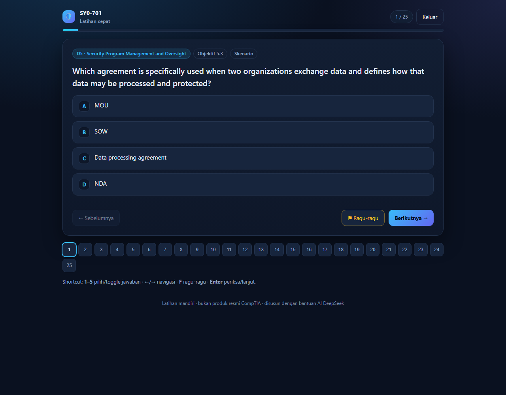
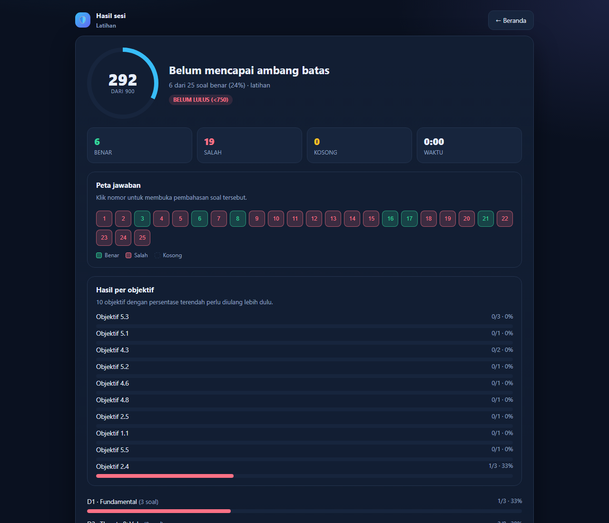
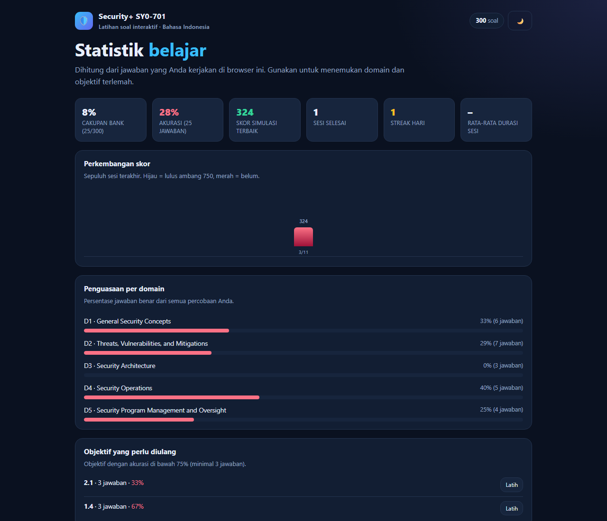
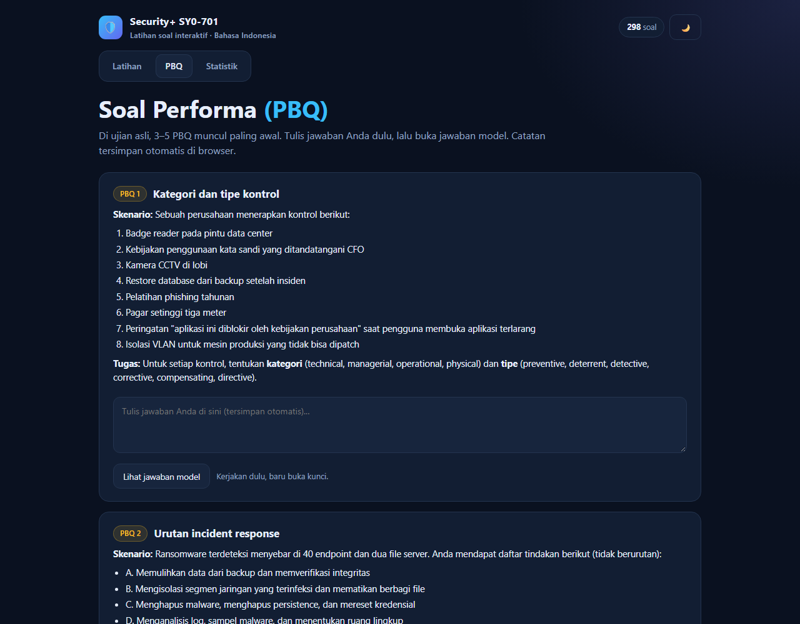

# CompTIA Security+ (SY0-701) — Bank Soal & Latihan

**300 soal pilihan ganda + 12 soal performa (PBQ)**, semuanya dengan pembahasan Bahasa Indonesia. Soal disusun mengikuti lima domain resmi SY0-701, bukan salinan soal ujian.

> **Tentang pembuatan:** seluruh bank soal, pembahasan, dan aplikasi latihan ini **disusun dengan bantuan kecerdasan buatan (AI) DeepSeek**. Materi tetap perlu diverifikasi ke objektif resmi CompTIA; gunakan sebagai latihan, bukan sumber kebenaran tunggal.

## Mulai cepat

| Kalau Anda ingin… | Buka |
|---|---|
| Latihan interaktif: simulasi ujian, PBQ, statistik | **[`dist/quiz.html`](dist/quiz.html)** — klik dua kali, jalan offline di browser |
| Membaca semua soal + pembahasan | [`dist/bank-soal-lengkap.md`](dist/bank-soal-lengkap.md) |
| Cetak / belajar dari HP | [`dist/Security-Plus-SY0-701-Bank-Soal.pdf`](dist/Security-Plus-SY0-701-Bank-Soal.pdf) |
| Mengedit atau menambah soal | [`bank-soal/`](bank-soal/) |









## Format ujian SY0-701

| Item | Keterangan |
|---|---|
| Jumlah soal | maksimal **90** |
| Waktu | **90 menit** |
| Skor | **100–900**, lulus **750** |
| Tipe soal | pilihan ganda satu jawaban, sesekali **multi-select** (pilih dua/tiga), dan **3–5 PBQ** (simulasi) |
| Opsi jawaban | **4 opsi** untuk pilihan tunggal (mesin mendukung hingga A–F), **5 opsi** untuk multi-select |
| Esai | **tidak ada** |
| PBQ | muncul di awal ujian, berbentuk drag-and-drop/konfigurasi/analisis, dan dapat diberi nilai parsial |

PBQ yang umum: menempatkan perangkat di zona jaringan, menyusun aturan firewall/ACL, membaca log, hardening endpoint, mengatur IAM least privilege, memilih algoritma kriptografi, konfigurasi SSID Wi-Fi, dan memprioritaskan kerentanan.

> CompTIA tidak mengumumkan jumlah pasti PBQ per versi ujian; laporan kandidat menyebut 3–5. Versi SY0-701 dijadwalkan pensiun **11 Juni 2027**, dan penerus SY0-801 diperkirakan hadir sekitar **November 2026** — cek [halaman resmi CompTIA](https://www.comptia.org/certifications/security) sebelum membeli voucher. Rincian format di atas juga merujuk pada [ringkasan format SY0-701](https://mindsetcyber.com.au/guides/comptia-security-plus-exam-objectives-sy0-701/).

## Isi bank soal

| Domain | Materi | Bobot ujian | Soal | Termasuk multi-select |
|---|---|---|---|---|
| 1 | General Security Concepts | 12% | 38 | 2 |
| 2 | Threats, Vulnerabilities, and Mitigations | 22% | 78 | 4 |
| 3 | Security Architecture | 18% | 50 | 2 |
| 4 | Security Operations | 28% | 82 | 4 |
| 5 | Security Program Management and Oversight | 20% | 52 | 2 |
| — | Performance-based questions (PBQ) | — | 12 | — |

Total **300 MCQ + 12 PBQ**. Kunci jawaban pilihan tunggal disebar merata di A/B/C/D (±75 each) supaya tidak bisa ditebak polanya; jawaban multi-select juga divariasikan.

## Fitur `quiz.html`

- **Ujian Simulasi** — 90 soal, 90 menit, komposisi domain sesuai bobot resmi, skor 100–900 dengan ambang 750. Jawaban bisa diubah sampai submit; timer habis = auto-submit.
- **Latihan per Domain** — 20 soal acak dari satu domain.
- **Latihan Cepat** — 25 soal acak lintas domain tanpa timer.
- **Ulangi yang Salah** — soal yang pernah salah disimpan di browser dan hilang otomatis setelah dijawab benar.
- **Latihan per Objektif** — fokus ke sub-objektif tertentu, misalnya `4.6` IAM atau `3.3` Data Protection.
- **Tab PBQ** — 12 PBQ dengan kotak jawaban (tersimpan otomatis) dan tombol buka jawaban model.
- **Tab Statistik** — cakupan bank, akurasi, penguasaan per domain, grafik 10 sesi terakhir, streak hari, objektif terlemah (dengan tombol *Latih*), dan status PBQ.
- **Tab Panduan** — penjelasan jenis soal, aturan penilaian, dan cara skor dihitung.
- **Multi-select** — pilih dua/tiga opsi, dinilai **all-or-nothing**; tidak ada nilai parsial.
- **Tanpa bocoran** — benar/salah tidak ditampilkan selama sesi; peta soal hanya menunjukkan status (biru belum, hijau terjawab, kuning ragu-ragu).
- **Wajib hapus tanda ragu-ragu** sebelum bisa submit; soal kosong tetap boleh disubmit dengan peringatan.
- **Peta jawaban & hasil per objektif** — setelah selesai, klik nomor di peta untuk membuka pembahasan soal tersebut; objektif terlemah diurutkan paling atas.
- **Penilaian PBQ mandiri** — tandai *Paham* / *Belum paham* per PBQ, tercatat di statistik.
- **Riwayat bisa dibuka lagi** — setiap sesi baru menyimpan daftar soal dan jawaban, jadi tombol *Pembahasan* di riwayat membuka ulang hasil lengkap (skor, peta jawaban, pembahasan). Sesi lama tanpa data detail ditandai “tanpa detail”.
- **Backup & pindah perangkat** — ekspor seluruh progres ke JSON, impor kembali kapan saja; ukuran data ditampilkan di tab Statistik.
- **Mode server SQLite opsional** — `python tools/server.py` menyimpan riwayat ke `data/history.db`.
- **Navigasi tengah** — tombol *Sebelumnya* di kiri, *Ragu-ragu* di tengah (kuning saat aktif), *Lanjut* di kanan.
- **Tema terang/gelap**, navigasi grid soal, shortcut keyboard (`1`–`6`, `←`/`→`, `F`).

> Skor 100–900 adalah simulasi sederhana (persentase benar dipetakan ke skala), bukan penskoran resmi CompTIA. Anggap ≥750 sebagai indikasi siap, bukan jaminan.

## Aturan penilaian

| Jenis | Cara dinilai |
|---|---|
| Pilihan ganda | 1 poin bila tepat; salah/kosong 0 |
| Multi-select | **all-or-nothing** — semua pilihan benar dan tidak ada yang berlebih |
| PBQ | Di ujian asli dinilai **parsial per komponen**; di aplikasi ini dinilai mandiri (Paham/Belum) |
| Esai | Tidak ada di SY0-701; bila ada, dinilai manual dengan rubrik |

Skor simulasi: `100 + 8 × persentase benar` (100–900). Lulus ≥750, setara ±81% benar. Ujian asli memakai *scaled score* dengan bobot soal yang tidak dipublikasikan.

**Aturan sesi:** benar/salah tidak ditampilkan sampai selesai; jawaban bisa diubah; soal bertanda ragu-ragu harus dihapus sebelum submit; timer habis → auto-submit.

## Penyimpanan data

Ada dua mode, terdeteksi otomatis:

1. **Buka `quiz.html` langsung (default).** Riwayat disimpan di **localStorage browser**. Tidak perlu server, tidak perlu instalasi — cukup klik dua kali. Browser tidak mengizinkan halaman `file://` menulis file database sendiri, jadi ini satu-satunya cara yang tetap “tinggal buka”.
2. **Server SQLite (opsional).** Jalankan `python tools/server.py`, lalu buka `http://127.0.0.1:8000`. Halaman mendeteksi `/api/health` dan menyimpan riwayat ke **`data/history.db`** (SQLite). Data tetap ada walau cache browser dibersihkan, dan bisa dibackup sebagai file.

Ukuran data di localStorage kecil: 30 sesi × ±2 KB ≈ **60 KB** dari kuota ±5 MB. Tab *Statistik* menampilkan ukuran aktual, dan tombol **💾 di header** membuka **Backup & restore**:

- **Ekspor backup** → file `security-plus-history-YYYY-MM-DD.json` berisi riwayat, statistik, daftar soal salah, dan status PBQ.
- **Impor file** di perangkat lain → sesi digabung berdasarkan timestamp (tidak dobel), lalu statistik dihitung ulang. Jadi progres dari beberapa perangkat bisa digabung.
- Waktu backup terakhir diingat; jika sudah 7 hari belum backup, hasil sesi menampilkan pengingat.

> Tidak ada penulisan file otomatis saat hanya membuka HTML: browser memblokir halaman `file://` menulis file. Backup/impor JSON adalah cara paling praktis tanpa server.

> Jika orang lain meng-clone repo dan hanya membuka `dist/quiz.html`, aplikasi tetap berjalan penuh; riwayat tersimpan di browser masing-masing. Untuk riwayat yang tersentral di file, jalankan server SQLite.

## Rencana belajar 4 minggu

| Pekan | Fokus | Target harian |
|---|---|---|
| 1 | Domain 1 + 2 (kontrol, kriptografi, threat actor, vektor, kerentanan) | 25 soal + baca ulang pembahasan yang salah |
| 2 | Domain 3 (arsitektur, cloud, data, resiliensi) | 25 soal + ringkas tabel perbandingan |
| 3 | Domain 4 (hardening, vuln mgmt, monitoring, IAM, IR) | 30 soal, bagi per sub-objektif |
| 4 | Domain 5 + PBQ + simulasi penuh | 2× Ujian Simulasi + ulangi semua soal salah |

Aturan belajar yang penting:

1. **Jawab dulu, baru buka kunci.** Untuk PDF, kerjakan satu domain lalu periksa bagian kunci.
2. **Baca pembahasan soal yang benar juga** bila jawaban Anda hasil tebakan.
3. **Catat pola salah**, bukan hanya materinya: salah baca kata kunci (`BEST`, `MOST`, `FIRST`, `MINIMAL`), tertukar istilah mirip (IDS/IPS, RADIUS/TACACS+, RTO/RPO), atau tidak hafal angka (CVSS, port, masa retensi).
4. **Ulangi soal salah setelah 2–3 hari.** Gunakan mode *Ulangi yang Salah* dan cek *Statistik* untuk melihat objektif terlemah.
5. **Latih PBQ secara terpisah.** Tulis jawaban di tab PBQ sebelum membuka jawaban model.
6. **Seminggu terakhir**: satu simulasi 90 menit setiap 2 hari, lalu bedah soal yang salah.

## Materi yang sering keluar dan sering tertukar

- Kategori kontrol (technical/managerial/operational/physical) vs tipe (preventive/deterrent/detective/corrective/compensating/directive)
- Zero trust: policy engine vs policy administrator vs policy enforcement point
- Enkripsi: symmetric vs asymmetric, hashing + salt, tokenization vs masking, HSM vs TPM vs secure enclave
- Serangan: on-path, ARP/DNS poisoning, VLAN hopping, deauth, evil twin, credential stuffing vs password spraying
- Arsitektur: fail-open vs fail-closed, inline vs passive, DMZ, ZTNA vs VPN, SASE
- Data: at rest/in transit/in use, sovereignty, retention, sanitization
- Resiliensi: RTO vs RPO, hot/warm/cold site, 3-2-1 backup, MTTR vs MTBF
- Operasi: SIEM vs SOAR vs EDR vs XDR, FIM, NAC, DLP
- IAM: DAC/MAC/RBAC/ABAC, SAML vs OAuth vs OIDC, RADIUS vs TACACS+, Kerberos, PAM, JIT
- Risiko: SLE/ALE/ARO, risk response (avoid/mitigate/transfer/accept), risk register, residual risk
- Tata kelola: policy vs standard vs procedure vs guideline, MOU/MOA/BPA/NDA/SLA/DPA, SOC 2 Type I vs II

## Struktur repo

```
bank-soal/                    sumber soal (Markdown, mudah diedit)
  01-general-security-concepts.md
  02-threats-vulnerabilities-mitigations.md
  03-security-architecture.md
  04-security-operations.md
  05-security-program-management.md
  06-performance-based.md     PBQ
tools/
  parse_bank.py               Markdown -> dist/questions.json (validasi format)
  balance_options.py          meratakan posisi jawaban
  build_html.py               membuat quiz.html (termasuk PBQ + statistik)
  build_md.py                 menggabungkan semua soal + pembahasan
  build_docx.py               membuat DOCX (soal, kunci, PBQ)
  server.py                   server lokal + SQLite (opsional, untuk riwayat)
  test_quiz.mjs               smoke test logika kuis (Node, tanpa browser)
dist/                         hasil build (jangan diedit manual)
data/history.db               database SQLite (dibuat server, tidak di-commit)
```

### Menjalankan mode server (opsional)

```powershell
python tools/server.py
# buka http://127.0.0.1:8000
```

Riwayat disimpan di `data/history.db`. Tanpa server, semua fitur tetap jalan dan riwayat memakai localStorage browser.

### Build ulang

Butuh Python 3 dengan `python-docx`, Node.js, dan LibreOffice Kit (untuk PDF).

```powershell
python tools/parse_bank.py
python tools/build_html.py
python tools/build_md.py
python tools/build_docx.py
node tools/test_quiz.mjs
```

Konversi PDF memakai LibreOffice Kit CLI:

```powershell
node <libreoffice-kit>/lib/cli.js convert `
  --input dist/Security-Plus-SY0-701-Bank-Soal.docx `
  --output dist/Security-Plus-SY0-701-Bank-Soal.pdf
```

Format soal yang dipakai `parse_bank.py`:

```markdown
## Soal 1
**Objektif:** 1.1
**Tipe:** Skenario
**Soal:** Teks pertanyaan…
- A. Opsi pertama
- B. Opsi kedua
- C. Opsi ketiga
- D. Opsi keempat
**Jawaban:** B
**Pembahasan:** Penjelasan dalam Bahasa Indonesia.
```

Untuk soal multi-select, gunakan lima opsi dan tulis jawaban dipisah koma:

```markdown
**Jawaban:** A, C
```

## Catatan

- Soal dibuat dengan bantuan **AI DeepSeek** untuk latihan mandiri, **bukan** soal resmi CompTIA, bukan brain dump, dan tidak berafiliasi dengan CompTIA, Inc.
- Materi mengacu pada objektif SY0-701 v1.0. Selalu cek [situs resmi CompTIA](https://www.comptia.org/certifications/security) untuk detail ujian terbaru (harga, jumlah soal, kebijakan).
- Ujian asli: maksimal 90 soal, 90 menit, skor 100–900, lulus **750**; PBQ muncul di awal ujian.
